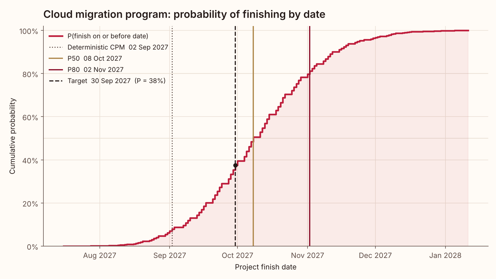
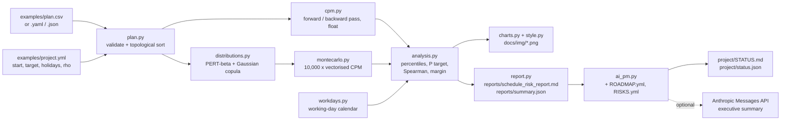
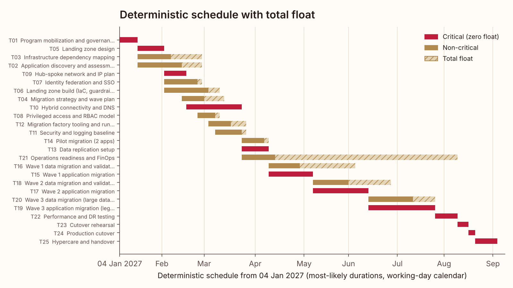
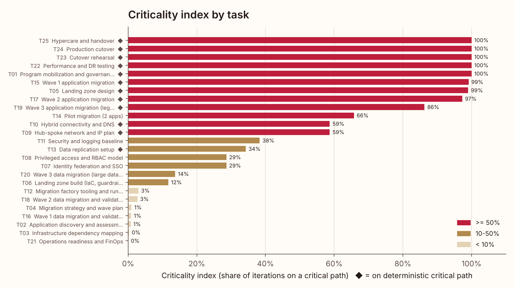
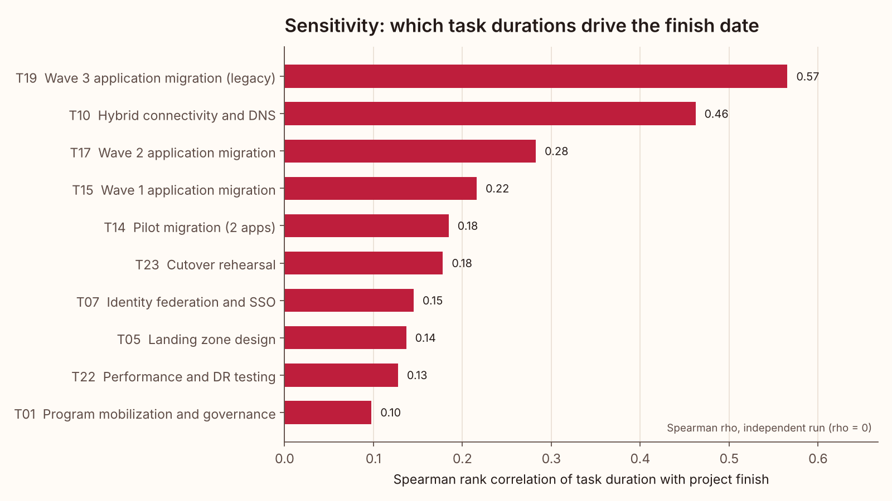
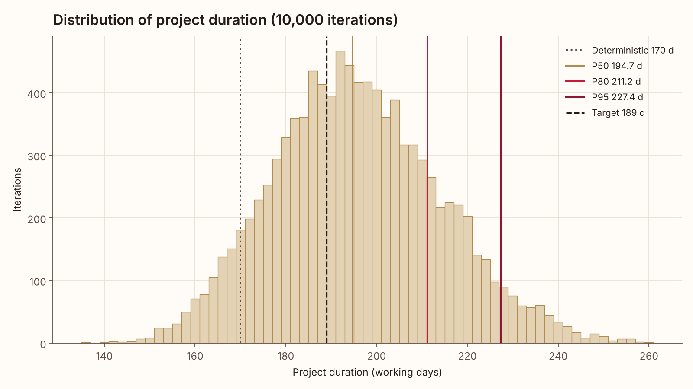

# Schedule Risk Monte Carlo (`riskpath`)

**Turn a task list with three-point estimates into a defensible commit date: CPM, 10,000-iteration Monte Carlo, criticality, sensitivity and a P80 schedule margin.**

[](https://github.com/laurenbmcguire/schedule-risk-montecarlo/actions/workflows/ci.yml)




*S-curve for the synthetic 25-task cloud migration plan: the deterministic CPM date has a 7.8% chance of holding; the P80 lands two months later.*

## Why it matters

- **Single-point plans are optimistic by construction.** When parallel workstreams merge, the latest one sets the date, so the "most-likely" CPM finish is rarely the most likely outcome. On the sample plan it is met in only 7.8% of simulated runs.
- **Margin should be sized, not guessed.** The P80 minus the deterministic finish gives a schedule reserve you can defend to a steering committee (42 working days on the sample plan) instead of a flat "add 20%".
- **Effort goes where the risk is.** Criticality and sensitivity rankings show which estimates to firm up and which "non-critical" tasks quietly become critical once uncertainty is modelled.

## What it does

- **Plan input** from CSV, YAML or JSON: a task DAG with `id, name, depends_on (";"-separated), optimistic, most_likely, pessimistic` in working days, plus optional `risk_event_prob` and `risk_event_days`. Cycles, unknown dependencies and inconsistent estimates are rejected with clear errors.
- **CPM engine**: forward and backward pass, early/late start and finish, total float, critical path.
- **Vectorised Monte Carlo** (numpy): 10,000 iterations of PERT-beta durations (lambda = 4), optional discrete risk events, and optional correlation through a Gaussian copula with configurable `rho`. Every iteration runs a full CPM pass, all iterations at once.
- **Per-iteration critical path**, giving a **criticality index** per task.
- **P50 / P80 / P95 finish dates** from a configurable start date on a working-day calendar (Mon-Fri minus a holiday list).
- **Probability of hitting a target date** and of hitting the deterministic date.
- **Sensitivity**: Spearman rank correlation of each task's duration with the project finish (tornado chart).
- **Schedule margin recommendation**: P80 minus deterministic, rounded up to whole working days.
- **Diagnostics**: merge bias, the P80 contribution of discrete risk events, and the effect of correlation on spread.
- **Outputs**: `reports/schedule_risk_report.md`, `reports/summary.json` and five charts in `docs/img/`.
- **AI Project Manager** that tracks this repo's own roadmap and risks and reports on what the latest run found.

## Architecture



## Results on the sample data

Synthetic 25-task "Cloud migration program" (discovery, landing zone, identity, network, three migration waves with data migration, cutover, hypercare). Start Mon 4 Jan 2027, target Thu 30 Sep 2027, 7 holidays, 10,000 iterations, seed 42, rho = 0.3. All numbers below are copied from `reports/summary.json`.

| Measure | Working days | Finish date |
|---|---:|---|
| Deterministic CPM (most-likely durations) | 170 | Thu 2 Sep 2027 |
| P50 | 194.7 | Fri 8 Oct 2027 |
| P80 | 211.2 | Tue 2 Nov 2027 |
| P95 | 227.4 | Wed 24 Nov 2027 |
| Mean (std) | 195.7 (18.5) | |

| Finding | Value |
|---|---:|
| Probability of meeting the deterministic date | 7.8% |
| Probability of meeting the 30 Sep 2027 target | 37.5% |
| ... if the same plan had no discrete risk events | 66.3% |
| Recommended schedule margin (P80 minus deterministic) | 42 working days (24.2%) |
| P80 added by discrete risk events | 14.7 days |
| P5-P95 spread, rho = 0.3 vs independent tasks | 61.1 vs 39.4 days |
| Merge bias (simulated mean without risk events minus CPM on PERT means) | 1.5 days |
| Top sensitivity driver | T19 Wave 3 application migration (Spearman 0.57) |
| Hidden critical task (has 2 days float in the plan) | T14 Pilot migration, critical in 66% of runs |

Two things the deterministic plan does not show: T13 *Data replication setup* sits on the CPM critical path but drives the finish in only 34% of runs, while T14 *Pilot migration* (2 days of float, plus a 30% chance of a 6-day slip) is critical in 66%. And because the target sits below the mean, correlation actually raises the chance of hitting it (37.5% vs 28.2% independent) while pushing the P80 out (211.2 vs 206.2 days): wider spread cuts both ways.

| Deterministic schedule with float | Criticality index |
|---|---|
|  |  |

| Sensitivity (tornado) | Duration distribution |
|---|---|
|  |  |

Full report: [`reports/schedule_risk_report.md`](reports/schedule_risk_report.md). The full pipeline (three 10,000-iteration simulations plus charts) took 2.7 s of compute in the development container.

## AI Project Manager

`python -m riskpath pm` treats this repository as a project. It reads [`project/ROADMAP.yml`](project/ROADMAP.yml) (milestones and backlog), [`project/RISKS.yml`](project/RISKS.yml) and the latest `reports/summary.json`, then writes [`project/STATUS.md`](project/STATUS.md) and `project/status.json`.

The deterministic engine always runs:

- **Health RAG** with explicit rules, first match wins: RED if a milestone is more than 14 days overdue, 2+ P0 items are open, or an open risk scores >= 20; AMBER if any milestone is overdue, any P0 is open, an open risk scores >= 15, or the pipeline summary is missing; otherwise GREEN.
- **Milestone table** with % done (share of linked backlog items done).
- **Risk register** sorted by score (probability x impact) with a heat label (Critical >= 20, High >= 15, Medium >= 8, Low).
- **Next 3 actions**: unblocked `todo` items ranked by priority, then by number of satisfied dependencies.
- **What the data says**: 3-5 bullets generated from `reports/summary.json`.
- **Decision / change log** entry.

Snippet of the committed [`project/STATUS.md`](project/STATUS.md):

```text
**Overall health: AMBER** - no overdue milestones or open P0 items, but open risk(s) scoring >= 15: R1 (score 16)

| # | ID | Action | Priority | Owner | Depends on (done) |
|---|---|---|---|---|---|
| 1 | B10 | Push repo and enable the weekly AI PM workflow | P1 | Lauren | B09 |
| 2 | B12 | Estimate-quality checks on three-point ranges | P1 | AI PM | B03 |
| 3 | B13 | MSPDI (MS Project XML) task and predecessor parser | P1 | Lauren | B02 |

## What the data says
- Deterministic CPM finish is 170 working days (2027-09-02), but only 7.8% of 10,000 simulated runs finish that early.
- Recommended schedule margin is 42 working days (24.2% of the deterministic plan), committing to 2027-11-02.
```

**LLM mode (optional).** If `ANTHROPIC_API_KEY` is set, the PM posts the computed facts JSON to the Anthropic Messages API (`https://api.anthropic.com/v1/messages`, standard-library `urllib`, model from `AI_PM_MODEL`, default `claude-sonnet-4-5`) and asks for a 90-120 word executive summary grounded only in those facts. With no key, or on any error or timeout, it falls back to a deterministic template, so the run never fails because of the LLM. Tests never touch the network. The committed status was produced in template mode.

**Automation.** [`.github/workflows/ai-pm.yml`](.github/workflows/ai-pm.yml) runs every Monday at 13:17 UTC (and on demand): install, `python -m riskpath run`, `python -m riskpath pm`, append STATUS.md to the job summary, and commit changed status, charts and reports as `github-actions[bot]`. Add `ANTHROPIC_API_KEY` as a repository secret to enable the narrative.

## Quickstart

```bash
git clone https://github.com/laurenbmcguire/schedule-risk-montecarlo.git
cd schedule-risk-montecarlo
pip install -e .
python -m riskpath run          # charts -> docs/img/, report -> reports/
python -m riskpath pm           # project/STATUS.md
pip install pytest && pytest -q
```

Use your own plan and settings:

```bash
python -m riskpath run --plan my_plan.csv --start 2027-03-01 --target 2027-12-17 --rho 0.2
python -m riskpath run --plan examples/plan.yaml        # YAML with an embedded settings block
python -m riskpath run --plan examples/mini_plan.json --target 2027-01-15
```

Settings precedence: built-in defaults < `examples/project.yml` < `settings:` block inside a YAML/JSON plan < CLI flags. If the example files are missing, `run` regenerates them.

## Project structure

```text
schedule-risk-montecarlo/
├── src/riskpath/
│   ├── plan.py            # Task/Plan model, CSV/YAML/JSON loaders, validation, topological sort
│   ├── cpm.py             # vectorised forward/backward pass, total float, critical path
│   ├── distributions.py   # PERT-beta and one-factor Gaussian copula
│   ├── montecarlo.py      # simulation, per-iteration criticality
│   ├── analysis.py        # percentiles, target probability, Spearman sensitivity, margin
│   ├── workdays.py        # working-day calendar
│   ├── charts.py, style.py
│   ├── report.py          # markdown report from summary
│   ├── pipeline.py        # end-to-end run
│   ├── sample.py          # synthetic example plan generator
│   ├── ai_pm.py           # AI project manager
│   └── cli.py, __main__.py
├── tests/                 # 26 pytest tests
├── examples/              # plan.csv, plan.yaml, mini_plan.json, project.yml
├── docs/img/              # charts produced by the pipeline
├── reports/               # schedule_risk_report.md, summary.json
├── project/               # ROADMAP.yml, RISKS.yml, STATUS.md, status.json
└── .github/workflows/     # ci.yml, ai-pm.yml
```

## Methodology

**CPM.** Tasks are topologically sorted (Kahn's algorithm). Forward pass: `ES_i = max_{p in pred(i)} EF_p` (0 for start tasks), `EF_i = ES_i + d_i`, project finish `T = max_i EF_i`. Backward pass: `LF_i = min_{s in succ(i)} LS_s` (T for end tasks), `LS_i = LF_i - d_i`. Total float `TF_i = LS_i - ES_i`; critical tasks have `TF_i = 0`. The deterministic plan uses most-likely durations with no risk events. The same code runs on a `(n_tasks, n_iterations)` matrix, so each Monte Carlo iteration gets its own exact CPM pass.

**PERT-beta durations.** For estimates `a <= m <= b` and shape `lambda = 4`:
`alpha = 1 + lambda (m - a)/(b - a)`, `beta = 1 + lambda (b - m)/(b - a)`, `d = a + (b - a) X` with `X ~ Beta(alpha, beta)`, so `E[d] = (a + lambda m + b)/(lambda + 2)`.

**Correlation.** A one-factor Gaussian copula: `Z_i = sqrt(rho) F + sqrt(1 - rho) e_i` with `F, e_i ~ N(0, 1)`, so any two tasks have latent correlation `rho`. Durations are `F_i^{-1}(Phi(Z_i))`, which keeps every marginal exactly PERT-beta. (Rank correlation between tasks is `(6/pi) asin(rho/2)`, about 0.29 for rho = 0.3.)

**Risk events.** Each task may carry a Bernoulli event: with probability `p` the task takes `risk_event_days` longer.

**Outputs.** Percentiles use linear interpolation over the 10,000 finishes. A finish of `D` working days ends on working day `ceil(D)` counted from the start date; dates skip weekends and listed holidays. `P(target) = share of iterations with ceil(D) <= working days through the target`. Criticality index = share of iterations with zero total float. Sensitivity = Spearman rank correlation between each task's sampled duration and the project finish, computed on the `rho = 0` run (same random numbers) so a shared correlation factor does not inflate every task. Recommended margin = `ceil(P80) - ceil(deterministic)` working days. Merge bias = mean simulated finish without risk events minus the CPM duration on PERT-mean task durations.

**Determinism and checks.** Fixed seeds (`numpy.random.default_rng`), common random numbers across the comparison runs. Tests cover a hand-computed CPM network, validation errors, loader equivalence, PERT moments against the analytic mean and median, zero-variance Monte Carlo equal to CPM, criticality on symmetric paths, merge bias, percentile convergence across seeds and iteration counts, correlation widening spread while preserving marginals, risk-event frequencies, sensitivity ranking, the calendar, margin math, the end-to-end pipeline and the AI PM rules.

**Limits.** Finish-to-start links only (no lags or SS/FF/SF yet), one global correlation coefficient, no resource levelling. Outputs are only as good as the three-point estimates (see risk R1).

## Data

All data in this repository is synthetic. The cloud migration plan in `examples/` is an illustrative set of tasks and estimates written for this portfolio project and generated by `riskpath.sample` (`write_sample`); it does not describe any real program, client or employer. Every metric quoted in this README and in the reports is computed by the code on that synthetic plan.

## Roadmap

From [`project/ROADMAP.yml`](project/ROADMAP.yml):

| Milestone | Due | Status |
|---|---|---|
| M1 CPM engine | 2026-09-18 | done |
| M2 Monte Carlo engine | 2026-10-02 | done |
| M3 Correlation and risk events | 2026-10-16 | done |
| M4 Reporting and charts | 2026-10-30 | done |
| M5 AI PM and CI automation | 2026-11-13 | in progress |
| M6 Estimate-quality guardrails | 2026-12-11 | planned |
| M7 MS Project XML import (MSPDI, link types and lags) | 2027-01-29 | planned |
| M8 Web UI (upload a plan, compare scenarios) | 2027-03-26 | planned |

## Author

**Lauren McGuire**, AI & Cloud Architect
[laurenmcguireresume.com](https://laurenmcguireresume.com) · [LinkedIn](https://www.linkedin.com/in/laurenbmcguire)

Licensed under the [MIT License](LICENSE).
