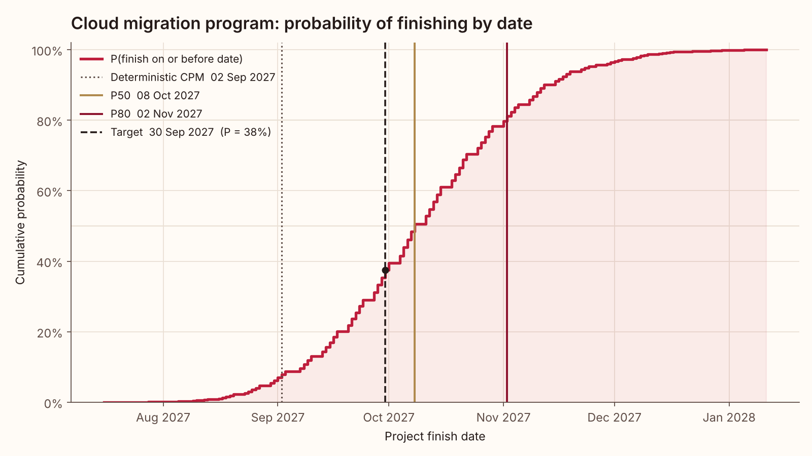
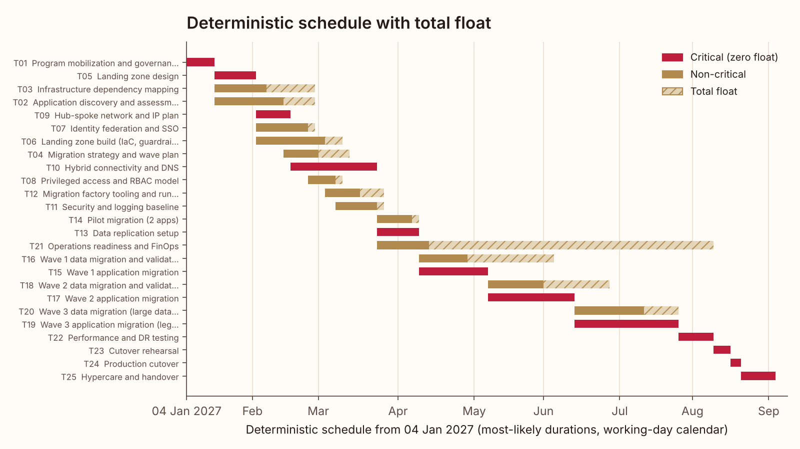
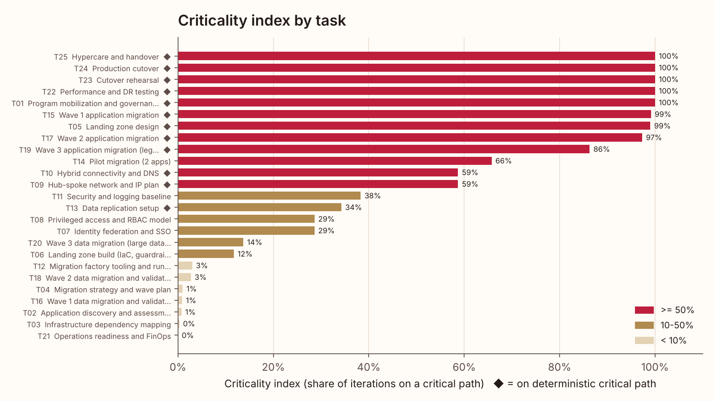
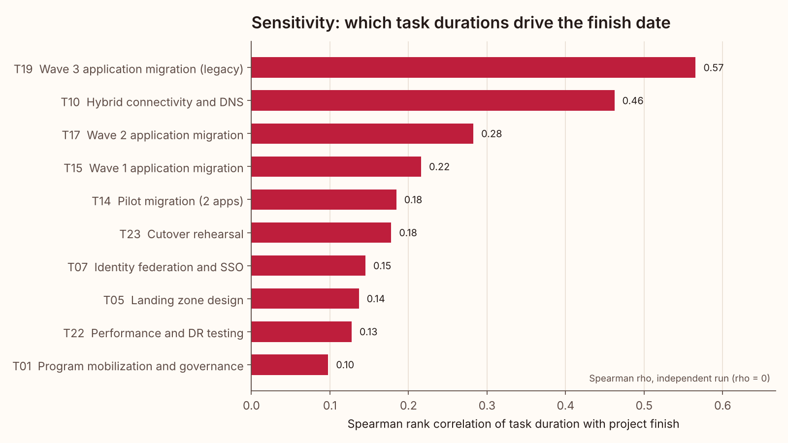
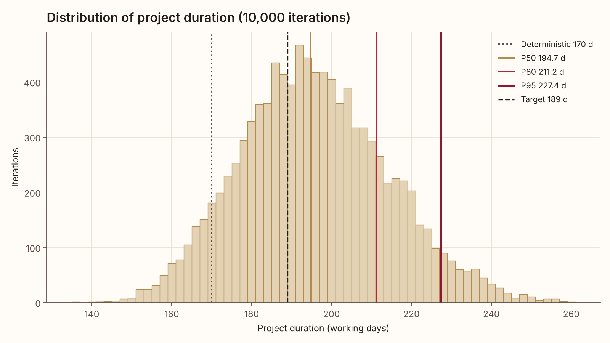

# Schedule risk report: Cloud migration program

25 tasks, 10,000 Monte Carlo iterations (seed 42), PERT-beta lambda = 4, Gaussian copula rho = 0.3. Start Mon 04 Jan 2027; calendar: Mon-Fri working days minus holidays (7 holidays).

> Synthetic example plan generated by `riskpath.sample`. Numbers below are computed by this run.

## Headline

| Measure | Working days | Finish date |
|---|---:|---|
| Deterministic CPM (most-likely) | 170 | Thu 02 Sep 2027 |
| P50 | 194.7 | Fri 08 Oct 2027 |
| P80 | 211.2 | Tue 02 Nov 2027 |
| P95 | 227.4 | Wed 24 Nov 2027 |
| Mean (std) | 195.7 (18.5) | |
| Target | 189 | Thu 30 Sep 2027 |

- Probability of meeting the deterministic date: **7.8%**.
- Probability of meeting the target (Thu 30 Sep 2027): **37.5%** (independent tasks: 28.2%; without discrete risk events: 66.3%).
- Recommended schedule margin: **42 working days** (P80 minus deterministic = 41.2 d, 24.2% of the plan). Commit to Tue 02 Nov 2027 rather than Thu 02 Sep 2027.
- Merge bias: CPM on PERT-mean durations gives 181.0 d, but the simulated mean without risk events is 1.5 d longer, because parallel paths converge and the latest one wins.
- Discrete risk events add 14.7 d at P80 (P80 without them: 196.5 d).
- Correlation: with rho = 0.3 the P5-P95 spread is 61.1 d versus 39.4 d if tasks were independent (P80 211.2 d vs 206.2 d).

## Deterministic critical path

T01 Program mobilization and governance -> T05 Landing zone design -> T09 Hub-spoke network and IP plan -> T10 Hybrid connectivity and DNS -> T13 Data replication setup -> T15 Wave 1 application migration -> T17 Wave 2 application migration -> T19 Wave 3 application migration (legacy) -> T22 Performance and DR testing -> T23 Cutover rehearsal -> T24 Production cutover -> T25 Hypercare and handover

## Criticality and sensitivity

Near-critical tasks (float > 0 in the deterministic plan, but critical in at least 20% of iterations): T07 Identity federation and SSO, T08 Privileged access and RBAC model, T11 Security and logging baseline, T14 Pilot migration (2 apps).

| Task | Name | O / M / P (d) | Risk event | Total float (d) | Criticality index | Spearman rho (rho = 0 run) |
|---|---|---|---|---:|---:|---:|
| T01 | Program mobilization and governance | 5 / 8 / 12 | none | 0 | 100.0% | 0.10 |
| T22 | Performance and DR testing | 8 / 10 / 18 | none | 0 | 100.0% | 0.13 |
| T23 | Cutover rehearsal | 3 / 5 / 8 | 20% x 5 d | 0 | 100.0% | 0.18 |
| T24 | Production cutover | 2 / 3 / 5 | none | 0 | 100.0% | 0.04 |
| T25 | Hypercare and handover | 10 / 10 / 15 | none | 0 | 100.0% | 0.06 |
| T15 | Wave 1 application migration | 15 / 20 / 30 | none | 0 | 99.1% | 0.22 |
| T05 | Landing zone design | 10 / 12 / 20 | none | 0 | 99.0% | 0.14 |
| T17 | Wave 2 application migration | 20 / 25 / 40 | none | 0 | 97.3% | 0.28 |
| T19 | Wave 3 application migration (legacy) | 20 / 30 / 50 | 30% x 12 d | 0 | 86.3% | 0.57 |
| T14 | Pilot migration (2 apps) | 8 / 10 / 18 | 30% x 6 d | 2 | 65.7% | 0.18 |
| T09 | Hub-spoke network and IP plan | 8 / 10 / 16 | none | 0 | 58.7% | 0.07 |
| T10 | Hybrid connectivity and DNS | 18 / 25 / 45 | 35% x 15 d | 0 | 58.7% | 0.46 |
| T11 | Security and logging baseline | 8 / 12 / 20 | none | 2 | 38.3% | 0.07 |
| T13 | Data replication setup | 8 / 12 / 20 | none | 0 | 34.3% | 0.05 |
| T07 | Identity federation and SSO | 10 / 15 / 25 | 30% x 10 d | 2 | 28.6% | 0.15 |
| T08 | Privileged access and RBAC model | 5 / 8 / 14 | none | 2 | 28.6% | 0.04 |
| T20 | Wave 3 data migration (large databases) | 15 / 20 / 35 | 30% x 10 d | 10 | 13.7% | 0.08 |
| T06 | Landing zone build (IaC, guardrails) | 15 / 20 / 30 | 25% x 10 d | 5 | 11.7% | 0.04 |
| T12 | Migration factory tooling and runbooks | 8 / 10 / 15 | none | 7 | 3.0% | 0.00 |
| T18 | Wave 2 data migration and validation | 12 / 16 / 28 | 25% x 8 d | 19 | 2.7% | 0.01 |
| T04 | Migration strategy and wave plan | 8 / 10 / 18 | none | 9 | 1.0% | -0.01 |
| T16 | Wave 1 data migration and validation | 10 / 14 / 24 | 20% x 7 d | 25 | 0.9% | 0.01 |
| T02 | Application discovery and assessment | 15 / 20 / 35 | none | 9 | 0.7% | -0.01 |
| T03 | Infrastructure dependency mapping | 10 / 15 / 25 | 20% x 8 d | 14 | 0.3% | -0.00 |
| T21 | Operations readiness and FinOps | 10 / 15 / 25 | none | 82 | 0.0% | -0.00 |

## Distribution

## How to read this

- The deterministic date assumes every task hits its most-likely estimate. It is a planning
  anchor, not a forecast; its probability is shown above.
- Criticality index is the share of iterations in which a task had zero total float.
- Sensitivity is the Spearman rank correlation between a task's sampled duration and the
  project finish, computed on the independent (rho = 0) run with the same random numbers so a
  shared correlation factor does not inflate every task. High values mark the estimates most
  worth refining.
- The margin recommendation is the gap between the P80 and the deterministic finish, rounded
  up to whole working days.
